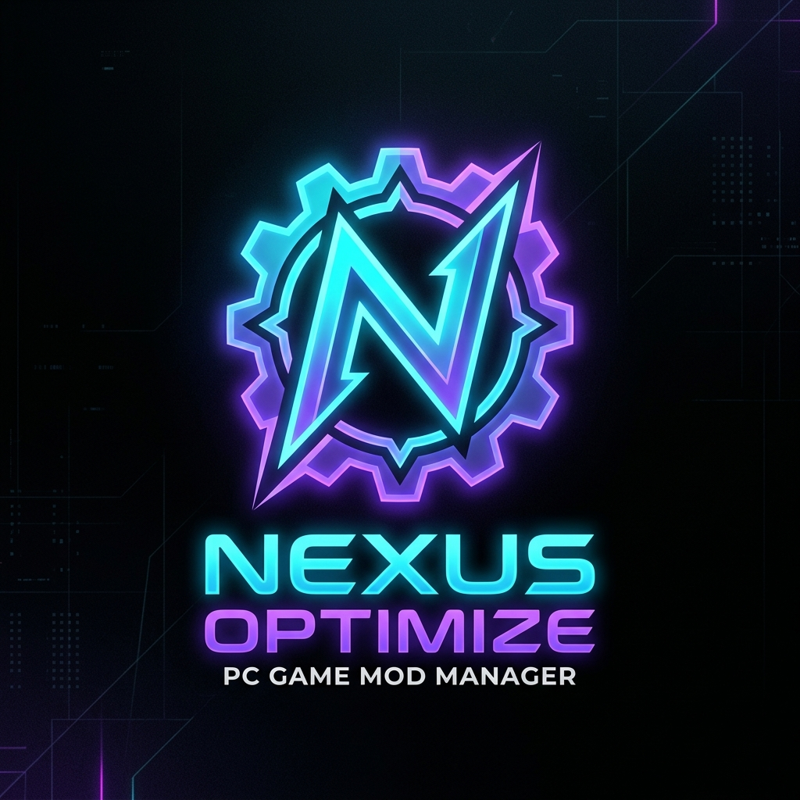



  
  
  # Nexus Optimize & Mod (v2.0)
  **The ultimate AAA Mod Manager, Performance Optimizer, and Telemetry Dashboard.**

## 🚀 Features

* **Universal Mod Router:** Intelligently routes mods for Unreal Engine, Glacier Engine, and automatically builds safe fallbacks for unsupported games.
* **Process Assassin (Ultra Game Mode):** Safely throttles heavy background apps (Chrome, Discord, Launchers) to IDLE priority while gaming to squeeze out every drop of CPU performance.
* **Benchmark Lab:** Records live ETW telemetry (via PresentMon) to accurately track your FPS, VRAM usage, and mathematically calculate 1% Lows.
* **Config Time Machine:** Automatically locks, pins, and snapshots your game's .ini files so you can instantly rollback if a patch breaks your settings.
* **Mod Bisect Engine:** A built-in binary search algorithm that automatically toggles halves of your modlist on/off to isolate exactly which mod is crashing your game.
* **Auto Save-Game Backups:** Automatically compresses your save files using maximum LZMA compression into a rolling 20-slot backup every time you close your game.
* **Obsidian Elite UI:** A buttery smooth, frosted-glass Cyberpunk interface built on Electron.

## 💾 Installation

1. Go to the **[Releases page](https://github.com/Nithinkumaru777/NexusOptimize/releases/latest)**.
2. Download the Nexus.Optimize.and.Mod.Setup.2.0.0.exe installer.
3. Run the installer to deploy the app to your desktop!

*(Note: The app relies on PresentMon to safely read frame times without triggering anti-cheat. You may need to run the app as Administrator for the FPS overlay to work).*

## 🛠️ Built With
* **Frontend:** Electron, HTML/CSS, Vanilla JS (GSAP/Framer-style CSS Motion)
* **Backend:** Python, FastAPI, SQLite (WAL Mode)
* **AI Engineered:** Co-developed by Antigravity and Claude Code.
